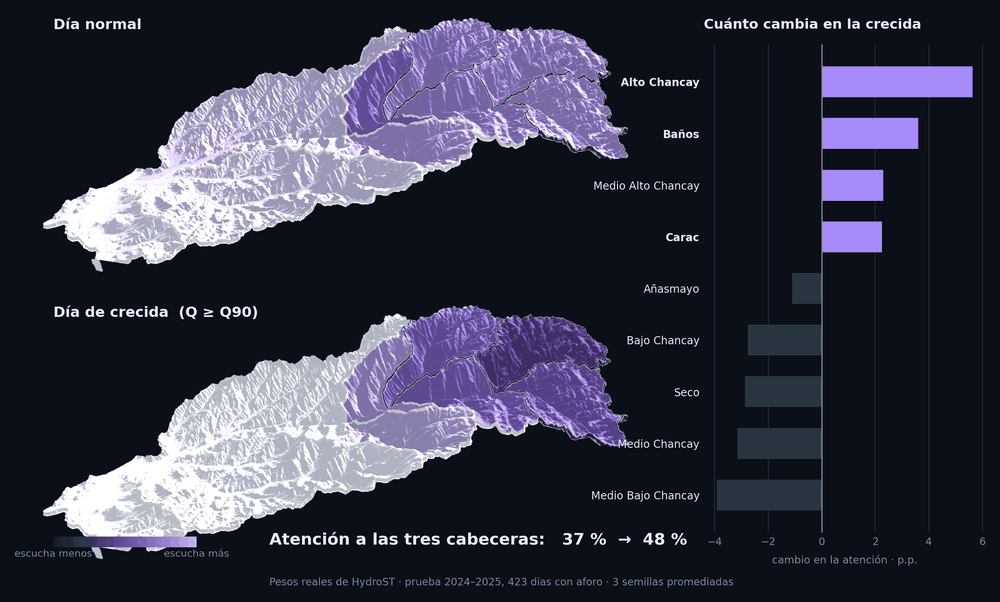
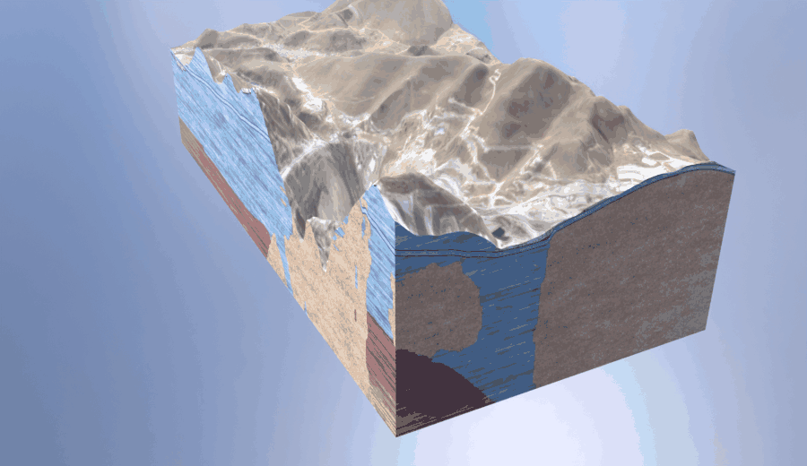
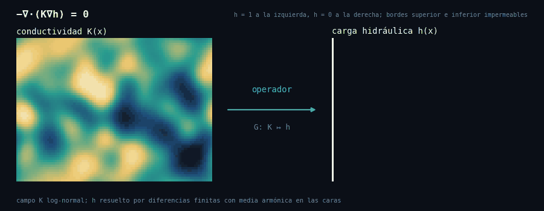
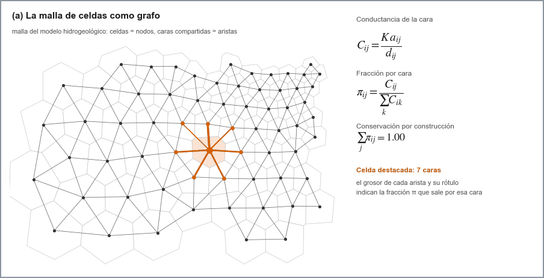
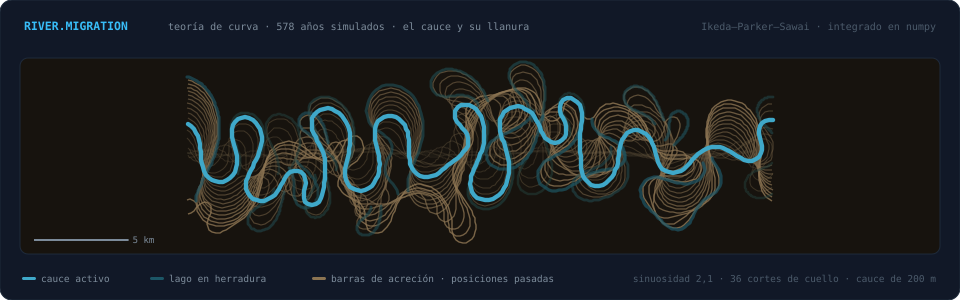
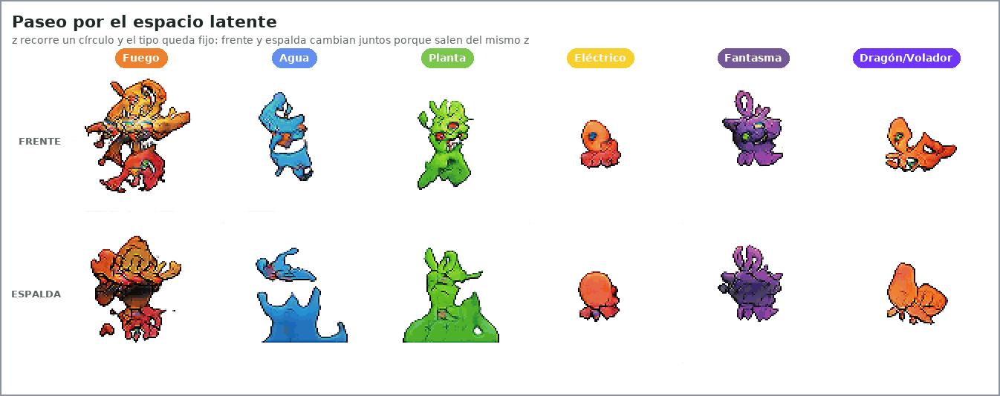

<a href="https://github.com/LuisContreras73">
  <picture>
    <source media="(prefers-color-scheme: dark)" srcset="assets/banner-dark.svg">
    <source media="(prefers-color-scheme: light)" srcset="assets/banner-light.svg">
    
  </picture>
</a>

Soy ingeniero ambiental y trabajo como Data Scientist en recursos hídricos. Desarrollo modelos
de agua que se puedan verificar: pronóstico de caudal, hidrogeología numérica y aprendizaje de
operadores. Me interesa que cada modelo se contraste con una medición en campo.

---

## HidroAlerta Chancay–Huaral

Sistema de pronóstico de caudal y alerta temprana para una cuenca andina. Usa tres modelos,
uno por escala de decisión:

| Modelo | Plazo | Acierto |
|---|---|---|
| **HydroST**, atención espacial sobre 9 subcuencas | 1 día | NSE **0,97** |
| **TFT canónico + GRU**, subestacional | 14 días | NSE **0,76** |
| **LightGBM cuantílico**, disponibilidad | 1 mes | KGE **0,77** |

El resultado es una banda P10–P90, que se contrasta con el nivel que mide un nodo IoT propio en
campo. El sistema tolera 30 días sin telemetría con una pérdida de solo 0,07 de NSE.

1.er puesto en el Concurso de Ciencia y Tecnología para la Seguridad Hídrica de la
Autoridad Nacional del Agua (2026). Está en implementación operativa.

[`código`](https://github.com/LuisContreras73/hidroalerta-chancay-huaral) ·
[`visor en vivo`](https://luiscontreras73.github.io/hidroalerta-dashboard)

<picture>
  <source media="(prefers-color-scheme: dark)" srcset="assets/inference-dark.svg">
  <source media="(prefers-color-scheme: light)" srcset="assets/inference-light.svg">
  
</picture>

En los 80 días del evento de enero a marzo de 2024, el caudal medido cayó dentro de la banda
P10–P90 el **82,5 %** de las veces, frente al 80 % nominal. Fuera de eventos la banda resulta
corta y el modelo es sobreconfiado; esa limitación está documentada en el informe.

En curso: modelos del mundo (*world models*) para dinámica de sistemas físicos, escalado
multicuenca con CAMELS-PE (136 cuencas peruanas) y operativización de HidroAlerta con la ALA
Chancay–Huaral.

### Atención espacial de HydroST

  <picture>
    <source media="(prefers-color-scheme: dark)" srcset="assets/atencion-dark.png">
    <source media="(prefers-color-scheme: light)" srcset="assets/atencion-light.png">
    
  </picture>

Durante una crecida, la atención espacial del modelo pasa del valle a las tres subcuencas de
cabecera sobre los 4 000 m, del 37 % al 48 %. Esas subcuencas aportan el 56 % del caudal. Los
pesos provienen de los checkpoints entrenados.

---

## Investigación actual

Trabajo en operadores neuronales y diseño generativo para la recarga de manantiales afectados
por minería. El operador aproxima el flujo subterráneo para explorar muchas alternativas de
diseño con rapidez. Cada alternativa seleccionada se verifica con una simulación en MODFLOW 6.
El motor de simulación corre en GPU.

Bloque hidrogeológico de un tajo a cielo abierto en los Andes del sur: geología, nivel freático y lago de cierre.
Datos públicos de expedientes ambientales; modelo en MODFLOW 6 con motor en GPU.
Imagen: contiene datos modificados de Copernicus Sentinel, 2024.

---

## Operadores neuronales y grafos

El flujo subterráneo en medio heterogéneo, `−∇·(K∇h) = 0`, es un problema de referencia para
operadores neuronales. En lugar de una solución concreta, el operador aprende la aplicación que
lleva un campo de conductividad `K` completo a su campo de carga `h`. En la animación, cada `h`
se resuelve por diferencias finitas con media armónica en las caras de las celdas.

Una malla de simulación es también un grafo: las celdas son nodos y las caras compartidas son
aristas. Cada cara tiene una conductancia `C_ij = K a_ij / d_ij`, y la fracción `π_ij = C_ij / Σ_k C_ik`
indica qué parte de lo que sale de la celda `i` pasa a la vecina `j`. Como las fracciones de cada
celda suman 1, el reparto conserva la masa por construcción. La animación usa celdas de la malla
del modelo con K uniforme; la suma total se calcula en cada fotograma.

## Migración de meandros

Simulación con la teoría de curva integrada en el tiempo: la migración de cada punto depende de
la curvatura aguas arriba, con memoria exponencial. Los lagos en herradura se forman cuando se
estrangula un cuello. La simulación cubre 578 años, con 36 cortes de meandro y una sinuosidad
de 2,1.

<picture>
  <source media="(prefers-color-scheme: dark)" srcset="assets/rio-dark.svg">
  <source media="(prefers-color-scheme: light)" srcset="assets/rio-light.svg">
  
</picture>

---

## PokeGAN

GAN condicional que genera criaturas en pixel art, de frente y de espalda, a partir de su tipo
(vector multi-hot de 18 tipos). El generador es de estilo BigGAN, con un tronco compartido y dos
cabezas. El discriminador es de proyección y se complementa con un término antagónico por pares.
Se entrenó con 7 739 pares en unas 3,5 horas en una GPU.

Coherencia entre frente y espalda de 0,93 y diversidad de 0,88 respecto a las imágenes reales.
KID×10³ de 24,0 (frente) y 42,8 (espalda); con un discriminador auxiliar ConvNeXt-T, 16,2 y 17,4.
La demo corre en el navegador con ONNX Runtime Web.

[`código`](https://github.com/LuisContreras73/pokegan) ·
[`demo`](https://luiscontreras73.github.io/pokegan/)

---

## Otros proyectos

- [`olas-de-calor-peru-utec`](https://github.com/LuisContreras73/olas-de-calor-peru-utec) — Olas de calor, IA y salud pública en el Perú: pieza interactiva de visualización de datos, del pronóstico global a 1 km (UTEC, 2026).
  [`pieza interactiva`](https://luiscontreras73.github.io/olas-de-calor-peru-utec/)
- [`music-generation`](https://github.com/LuisContreras73/music-generation) — Modelos autorregresivos generativos sobre música simbólica de piano: 16 experimentos, cuatro familias de arquitectura, mismo corpus y mismo protocolo. Predecir mejor no es generar mejor.
- [`overcooked-final`](https://github.com/LuisContreras73/overcooked-final) — Agente Overcooked-AI, proyecto final de Deep Learning.
- [`lab4-planning-llm`](https://github.com/LuisContreras73/lab4-planning-llm) — Laboratorio 4: planificación multipaso con Qwen3-8B (Hyperion.net).
- [`hidroalerta-dashboard`](https://github.com/LuisContreras73/hidroalerta-dashboard) — visor de HidroAlerta.

---

## Herramientas

<table>
  <tr>
    <td width="50%" valign="top"><b>Operadores neuronales</b>  
      
      
       
      FNO · DeepONet · Neural ODE
    </td>
    <td width="50%" valign="top"><b>Modelos generativos</b>  
      
      
       
      Diffusion · VAE · Flow Matching · GAN
    </td>
  </tr>
  <tr>
    <td valign="top"><b>Transformers y grafos</b>  
      
      
       
      Attention · GNN (GCN/GAT) · TFT · conformal
    </td>
    <td valign="top"><b>Hidrogeología y física</b>  
      <code>∇·(K∇h) = Ss ∂h/∂t</code>  
      FEFLOW · MODFLOW · GR4J · PINNs · balance hídrico
    </td>
  </tr>
  <tr>
    <td valign="top"><b>Datos y geoespacial</b>  
      
      
      
       
      SQL · DuckDB · xarray · Earth Engine · QGIS · rasterio
    </td>
    <td valign="top"><b>Ingeniería y campo</b>  
      
       
      Arch · Ubuntu · Git · Docker · ESP32 · LoRa · KiCad
    </td>
  </tr>
</table>

---

## Contacto

